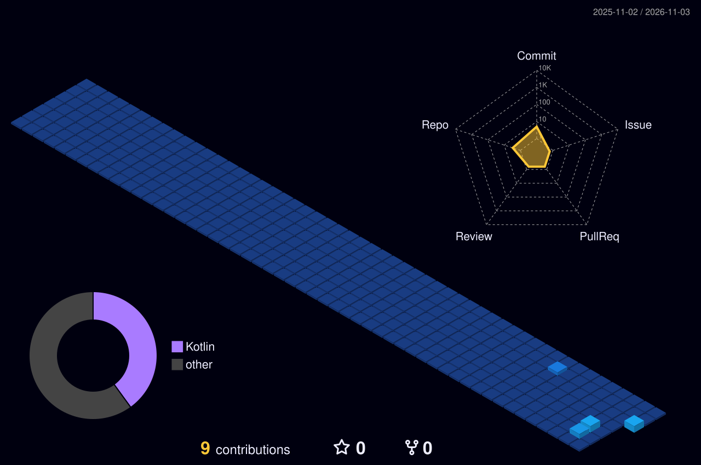

 

**I build free AI tools, Android apps and web utilities, and I publish the source code.**

## 👋 About me

- 🔭 **Building:** the **Hay\*** family of apps, plus HaiWeb, HeyEncrypt and an open-directory finder
- 🤝 **Open to:** collaborating on Android and web projects
- 🌱 **Learning:** AI-powered tooling and Android performance
- 💬 **Ask me about:** my projects, free tools and open source
- 📍 **Based in:** West Bengal, India (UTC+05:30)

## 🚀 Featured projects

| Project | What it does | Stack |
| :-- | :-- | :-- |
| [**HayGo**](https://github.com/sourceium/HayGo.app) | Fast, dark-themed Android browser with Picture-in-Picture, background play, ad blocker, tabs, Desktop/Tablet view, reader mode and built-in dev console. Free and open source. | `HTML` `Android` |
| [**GameyFi**](https://github.com/sourceium/GameyFi) | Free, static browser game library. | `HTML` `JS` |
| [**app-info**](https://github.com/sourceium/app-info) | App info page, live at [haiappinfo.vercel.app](https://haiappinfo.vercel.app). | `HTML` `Vercel` |
| [**Weather.app**](https://github.com/sourceium/Weather.app) | Simple weather app. | `HTML` |
| [**HayEruda.app**](https://github.com/sourceium/HayEruda.app) | Part of the Hay* app family. | `HTML` |
| [**Hayone.app**](https://github.com/sourceium/Hayone.app) | Part of the Hay* app family. | `HTML` |

[**→ See all repositories**](https://github.com/sourceium?tab=repositories)

## 🛠️ Tech stack

## 🌃 Contribution activity

## ☕ Support

If my free tools save you time, you can support the work via [PayPal](https://paypal.me/Haldarai2007). Starring a repo helps just as much. ⭐

